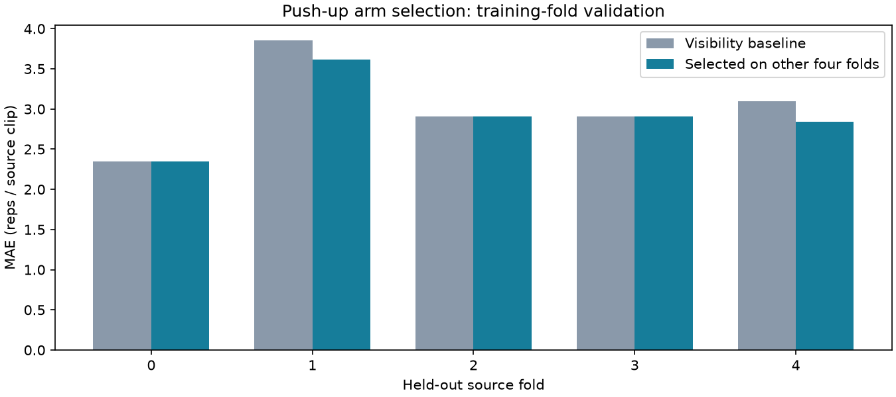

# Motion-aware push-up arm selection (17 November 2026)

The previous local-threshold push-up improvement is committed as `054a109`.
This follow-on change selects the counting arm using tracking visibility,
continuity, and periodic motion. It never uses annotated or predicted rep counts
to score an arm. Squat/jumping-jack selection, segmentation weights, and the
existing push-up thresholds and timing settings are unchanged.

## Implementation

Both elbow signals are cleaned using the existing gap handling and smoothing.
Arms must pass the existing valid-data and motion-amplitude guards. Within each
continuous tracking interval, detrended spectral power measures how strongly
motion concentrates around a plausible repetition frequency (0.2-3 Hz).
The selected score is `2 * visibility + continuity + 4 * periodicity`.
Stable score ties retain the original visibility preference. An unusable arm
cannot displace a usable one. This is an offline, whole-segment selection policy.

Pipeline exports now include the selection policy and each arm's quality
measurements and score, so a changed arm choice is inspectable. Explicit
`arm_selection="visibility"` reproduces the previous preference for comparison.
The evaluator also records the separate arm-quality implementation hash.

## Training-fold validation

All validation uses 155 push-up exercise segments from 81 source clips in the
five existing source-disjoint training folds. Reused clips have one weight
within their fold. Ground-truth windows isolate counting from segmentation.
No test feature frames are loaded and the test set was not rerun.

| Evaluation | Previous visibility choice | Motion-aware choice |
|---|---:|---:|
| Mean source-weighted fold MAE, settings selected on all train | 3.021 | 2.865 |
| Mean source-weighted held-out fold MAE, settings selected on other four folds | 3.021 | 2.924 |

The all-training improvement is 5.2%; the held-out-fold improvement is 3.2%.
For the selected fixed policy, folds 1 and 4 improve while folds 0, 2, and 3
have unchanged aggregate MAE. Individual clips can regress.

An initial exploratory search allowed unrestricted motion/visibility/smoothness
weights; its held-out-fold behavior was unstable. The final simpler family fixes
visibility weight at 2 and continuity at 1, tests periodicity weights
0.5/1/2/4 and switch margins 0/0.1/0.25/0.5/1/2, plus the previous visibility
baseline (25 policies). Selection minimizes mean source-weighted fold MAE with
deterministic ties. Each held-out check selects among policies using only the
other four folds. Because the policy family itself was developed using training
results, these are exploratory development checks, not unbiased nested-CV estimates.
The initial unrestricted candidate results are retained for transparency.

Runtime arm choices and counts were checked against both cached validation
policies on every one of the 155 segments. Quality scoring contains no annotations.
The retained test results describe the previous version; this report makes no
new test-performance claim. Missing pose data and some ambiguous motion remain
unresolved. Upstream pose selection is still annotation-assisted.

## Diagnostic plots



Eight training examples cover improvements, regressions, and large remaining
errors. Each plot shows both cleaned elbow signals, local normalized signals and
thresholds, annotated rep intervals, and predicted completion times for both
policies. Plot examples are illustrative selections, not independent evidence.

- [synth_v2_train_f4_0022 / stu8_44.mp4](motion_arm_selection_20261117/synth_v2_train_f4_0022_segment_04.png): absolute-error improvement +9 reps.
- [synth_v2_train_f1_0008 / stu10_49.mp4](motion_arm_selection_20261117/synth_v2_train_f1_0008_segment_03.png): absolute-error improvement +7 reps.
- [synth_v2_train_f1_0011 / stu4_43.mp4](motion_arm_selection_20261117/synth_v2_train_f1_0011_segment_01.png): absolute-error improvement +4 reps.
- [synth_v2_train_f1_0003 / stu1_51.mp4](motion_arm_selection_20261117/synth_v2_train_f1_0003_segment_03.png): absolute-error improvement +3 reps.
- [synth_v2_train_f3_0008 / stu10_46.mp4](motion_arm_selection_20261117/synth_v2_train_f3_0008_segment_02.png): absolute-error improvement -2 reps.
- [synth_v2_train_f4_0011 / stu9_51.mp4](motion_arm_selection_20261117/synth_v2_train_f4_0011_segment_05.png): absolute-error improvement -1 reps.
- [synth_v2_train_f2_0009 / stu2_53.mp4](motion_arm_selection_20261117/synth_v2_train_f2_0009_segment_05.png): absolute-error improvement +0 reps.
- [synth_v2_train_f1_0015 / stu10_49.mp4](motion_arm_selection_20261117/synth_v2_train_f1_0015_segment_01.png): absolute-error improvement +0 reps.

## Reproduce and inspect

```powershell
.venv/Scripts/python.exe -m src.rep_counting.validate_arm_selection --out-dir outputs/arm_selection/new_validation --plots 8
```

The command preserves existing output directories and verifies that the
selected policy matches the runtime configuration before writing its report.

- [Report, hashes, and held-out fold checks](motion_arm_selection_20261117/report.json)
- [Final policy candidates](motion_arm_selection_20261117/policies.csv)
- [Exploratory unrestricted policies](motion_arm_selection_20261117/exploratory_policies.csv)
- [Per-segment comparison](motion_arm_selection_20261117/comparison.csv)
- [Held-out predictions](motion_arm_selection_20261117/heldout_predictions.csv)
- [Arm-quality measurements and counts](motion_arm_selection_20261117/arm_candidates.csv)
