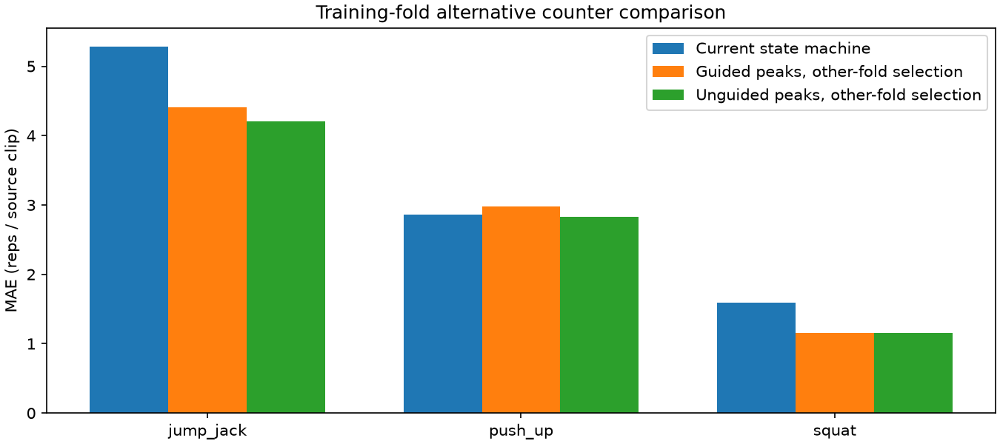

# Peak detection experiment (17 November 2026)

Implemented an opt-in offline repetition counter using prominence, minimum peak
width, and conservative autocorrelation-guided spacing. The production
state-machine baseline reflects the default at the time of this experiment. No test feature frames were evaluated.

## Method

Reuse the current cleaned joint signals and arm-selection policy to isolate the
counting algorithm. Bend minima are motion peaks for squats/push-ups; raised-arm
maxima are motion peaks for jumping jacks. Each finite tracking interval is
processed independently so a rep cannot span lost pose tracking.

Prominence is the larger of 8 degrees or a selected fraction of the interval's
p10/p90 angle range. Width is specified in seconds and converted to samples.
Autocorrelation estimates the first strong period between 0.3 and 5 seconds,
requiring at least three observed cycles and correlation >= 0.35. A detected
period may increase spacing, but never beyond one second (or reduce the existing
exercise-specific minimum gap). If the period is unreliable, spacing falls back
to that minimum. The counter reports the period, confidence, and effective spacing.

Motion extrema are not completion timestamps: after a detected peak the signal
must recover by 70% of its prominence before another detected peak or the end
of the finite interval. Completions too close together are rejected. This is an
offline method, including smoothing, prominence calculation, and recovery lookahead.

## Training-fold comparison

460 annotated exercise segments: 155 jumping-jack segments (66 source clips),
155 push-up segments (81 clips), and 150 squat segments (92 clips). Counts are
compared inside GT exercise windows, not predicted segmentation windows.
Reused source clips have equal weight within each fold; five folds receive equal
weight. These MAEs are different evaluation units and data from the previous
21-video test results; they should not be compared directly to those test MAEs.

Each peak family selects its settings on four training folds and scores the fifth.
The baseline is the legacy state-machine counter including motion-aware push-up arm selection.

| Exercise | State-machine MAE | Guided peaks MAE | Unguided peaks MAE |
|---|---:|---:|---:|
| Jumping jacks | 5.288 | 4.413 | 4.204 |
| Push-ups | 2.865 | 2.981 | 2.827 |
| Squats | 1.594 | 1.153 | 1.150 |

Guided peaks improve jumping-jack MAE by 16.5% and squat MAE by 27.6%, but
worsen push-up MAE by 4.0%. Unguided peaks are as good or better on these aggregate
results. The experiment supports further consideration of peak counting for
squats/jumping jacks; it does not establish an added benefit from autocorrelation
spacing or justify replacing push-up counting with guided peaks.

Ablations were included from the beginning: prominence fractions 0.15/0.25/0.35/0.45,
widths 1/15, 2/15, and 0.2 seconds; spacing fractions 0 (unguided), 0.35, 0.5, and 0.65
of the estimated period (48 configurations per exercise). Guided comparisons
select only among nonzero spacing fractions; unguided comparisons use zero.
Ties retain candidate order. The all-candidate search, also recorded in the
report, has different held-out settings/results and is not substituted for
these family-specific comparisons.

Selected on all training folds, guided settings use prominence fraction 0.25
for jumping jacks/squats and 0.45 for push-ups, width 1/15 second, and spacing
fraction 0.35. Wider width constraints were not favored in this search.
Settings selected on individual four-fold subsets are recorded separately.

## Temporal rep matching

A predicted completion is a hit if it lies inside one annotated rep interval,
expanded by 0.3 seconds at each end. Matching is one-to-one; missed and extra
reps cannot cancel. The table below pools segment occurrences, including source
reuse, rather than using the source-weighted MAE aggregation above. Peak timing
metrics use the settings selected on other folds.

| Exercise | Current precision | Current recall | Current F1 | Guided precision | Guided recall | Guided F1 |
|---|---:|---:|---:|---:|---:|---:|
| Jumping jacks | 97.02% | 79.46% | 87.37% | 96.56% | 84.45% | 90.10% |
| Push-ups | 91.29% | 87.85% | 89.54% | 91.50% | 87.18% | 89.29% |
| Squats | 98.39% | 88.63% | 93.25% | 95.67% | 92.83% | 94.23% |

## Plots and artifacts



Six diagnostic plots (a largest gain and a largest regression per exercise)
show the cleaned signal, selected motion peaks, annotated intervals, and both
methods' completion times. These are illustrative examples of the guided
configuration selected on all train, not independent validation evidence.

- [jump_jack_synth_v2_train_f3_0021_05](peak_counter_20261117/jump_jack_synth_v2_train_f3_0021_05.png)
- [jump_jack_synth_v2_train_f4_0010_05](peak_counter_20261117/jump_jack_synth_v2_train_f4_0010_05.png)
- [push_up_synth_v2_train_f0_0012_05](peak_counter_20261117/push_up_synth_v2_train_f0_0012_05.png)
- [push_up_synth_v2_train_f2_0009_05](peak_counter_20261117/push_up_synth_v2_train_f2_0009_05.png)
- [squat_synth_v2_train_f2_0008_05](peak_counter_20261117/squat_synth_v2_train_f2_0008_05.png)
- [squat_synth_v2_train_f2_0011_07](peak_counter_20261117/squat_synth_v2_train_f2_0011_07.png)

- [Report, selected settings, fold checks, and source/input hashes](peak_counter_20261117/report.json)
- [All candidate results](peak_counter_20261117/candidates.csv)
- [State-machine predictions](peak_counter_20261117/baseline_segments.csv)
- [Guided predictions selected on other folds](peak_counter_20261117/heldout_guided_segments.csv)
- [Guided predictions selected on all train](peak_counter_20261117/selected_guided_segments.csv)

## Reproduce and use

```powershell
.venv/Scripts/python.exe -m src.rep_counting.validate_peak_counter --out-dir outputs/peak_counter/new_experiment
```

The command refuses an existing directory and compares its cached predictions
with the public counting API for every training segment. It does not rewrite
counter defaults or load test feature frames.

```python
import json
from pathlib import Path
from src.rep_counting.peak_counter import PeakSettings, count_peaks_for_exercise

report = json.loads(Path("docs/results/peak_counter_20261117/report.json").read_text())
settings = PeakSettings(**report["exercises"]["squat"]["families"]["guided"]["settings"])
# df: canonical angle features; start_s/end_s: the exercise interval.
result = count_peaks_for_exercise(df, "squat", start_s, end_s, settings=settings)
```

These are exploratory training-data results, not an unbiased nested-CV estimate
or a new final-test claim. Baseline arm-selection settings were themselves
developed on training data. Upstream pose extraction is annotation-assisted.
No state-machine default was changed, no test data was evaluated, and no code
was committed or pushed for this experiment.
