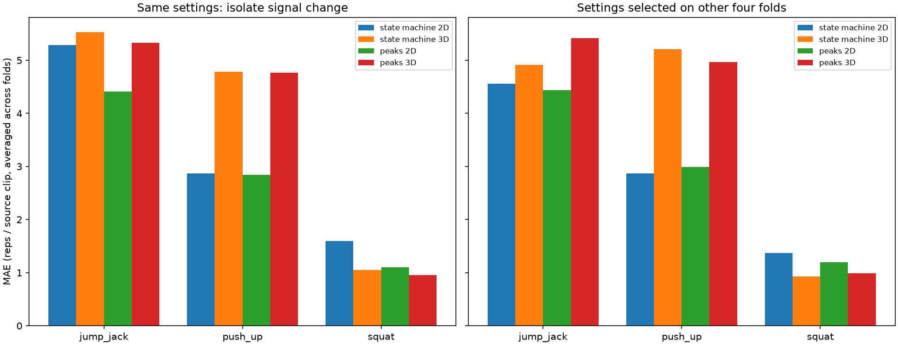

# Cached 2D versus world-3D rep signals (17 November 2026)

This experiment compares the legacy state-machine counter and the experimental
peak counter using existing 2D angles and MediaPipe world-landmark 3D angles.
It does not run pose extraction, change production defaults, or load test feature
frames. Estimated world-3D angles are not motion-capture ground truth.

## Controlled comparison

The same 460 annotated exercise segments are evaluated in both dimensions.
Strict column checks forbid the legacy 3D-to-2D fallback. Missing or motionless
3D data remains a zero count; segments are not excluded. Both dimensions use
the same smoothing, gap handling, visibility, motion-amplitude guards, arm-quality
scoring rule, and minimum rep spacing. The selected arm can differ because
motion quality is computed from the chosen dimensional signal.

The first comparison holds counter settings fixed: legacy state-machine
fractions/confirmation, and the previously selected guided-peak configuration
for each exercise. These settings were previously developed on training data.
The fixed comparison isolates changing the signal representation.

The second comparison selects parameters independently within each dimensional
signal and exercise. State machines search fractions (0.2/0.55, 0.35/0.65,
0.45/0.75) and confirmation durations (0/0.1/0.15 seconds): nine configurations.
Peak detection searches prominence fractions (0.15/0.25/0.35/0.45), widths
(1/15, 2/15, 0.2 seconds), and autocorrelation spacing fractions (0/0.35/0.5/0.65):
48 configurations, including the no-guidance ablation. The same search space is
used for 2D and 3D. Preprocessing, motion-amplitude guards, local-window length,
arm-quality weights, and minimum spacing are not retuned.

For each of five source-disjoint folds, settings are selected using the other
four folds, then evaluated on the held-out fold. Selection minimizes count MAE,
first averaging synthetic reuses of each source clip within its fold, then
averaging folds equally. Deterministic ties retain candidate order.

This is exploratory training-data development, not an unbiased nested-CV estimate.
Upstream person selection is annotation-assisted. GT exercise windows isolate
counting from segmentation; these metrics must not be compared directly to the
earlier video/exercise totals on test data.

## Count results

### Fixed settings: signal change only

| Exercise | State machine 2D | State machine 3D | Peaks 2D | Peaks 3D |
|---|---:|---:|---:|---:|
| Jumping jacks | 5.288 | 5.531 | 4.413 | 5.328 |
| Push-ups | 2.865 | 4.782 | 2.845 | 4.765 |
| Squats | 1.594 | 1.050 | 1.101 | 0.954 |

### Settings selected on the other four folds

| Exercise | State machine 2D | State machine 3D | Peaks 2D | Peaks 3D |
|---|---:|---:|---:|---:|
| Jumping jacks | 4.562 | 4.913 | 4.435 | 5.414 |
| Push-ups | 2.865 | 5.205 | 2.993 | 4.968 |
| Squats | 1.370 | 0.928 | 1.197 | 0.992 |

3D improves squats under both fixed and independently tuned settings. For
state machines, held-out tuning gives 0.928 MAE in 3D versus 1.370 in 2D
(32.3% lower). For peaks, 3D gives 0.992 versus 1.197 (17.1% lower).
3D is worse for jumping jacks and push-ups with both methods in this comparison.
This supports a future exercise-specific configuration rather than a global
switch to 3D. Production settings remain unchanged.

The best development combination here is 3D state-machine squats, 2D
state-machine push-ups, and 2D peaks for jumping jacks. Choosing combinations
from these inspected results is itself development, not an independent test.
The peak search includes both guided and unguided variants; this table selects
among the full peak search, which differs from the prior guided-only table.

For squat state machines, the settings selected on all training folds are
fractions 0.35/0.65 and confirmation 0 seconds. Other preprocessing and minimum
spacing stay unchanged. Per-fold settings and full selected peak settings are
recorded in the machine-readable report.

## Rep-timing metrics after other-fold parameter selection

Matching is one-to-one against annotated intervals expanded by 0.3 seconds.
Timing scores pool synthetic segment occurrences, including reused clips;
they do not use the source-weighted aggregation of MAE. Exact match,
within-one, and WAPE use pooled segment occurrences and are also in report.json.

| Exercise | Counter | Signal | Precision | Recall | F1 |
|---|---|---|---:|---:|---:|
| jump_jack | state_machine | 2d | 96.85% | 82.66% | 89.20% |
| jump_jack | state_machine | 3d | 97.29% | 80.77% | 88.26% |
| jump_jack | peaks | 2d | 96.47% | 84.45% | 90.06% |
| jump_jack | peaks | 3d | 95.66% | 80.09% | 87.18% |
| push_up | state_machine | 2d | 91.29% | 87.85% | 89.54% |
| push_up | state_machine | 3d | 91.09% | 75.90% | 82.80% |
| push_up | peaks | 2d | 91.38% | 87.18% | 89.23% |
| push_up | peaks | 3d | 89.96% | 78.28% | 83.71% |
| squat | state_machine | 2d | 97.85% | 90.62% | 94.10% |
| squat | state_machine | 3d | 97.76% | 94.23% | 95.97% |
| squat | peaks | 2d | 95.91% | 92.35% | 94.10% |
| squat | peaks | 3d | 95.86% | 93.48% | 94.65% |

## Signal coverage

Coverage is the mean finite fraction across the two raw joint channels within
each segment, then averaged across segment occurrences. Usable segments pass
the existing cleaned-signal coverage and amplitude guards.

| Exercise | Signal | Raw coverage | Usable / all segments |
|---|---|---:|---:|
| jump_jack | 2d | 88.26% | 148 / 155 |
| jump_jack | 3d | 88.26% | 143 / 155 |
| push_up | 2d | 62.98% | 153 / 155 |
| push_up | 3d | 62.98% | 149 / 155 |
| squat | 2d | 80.23% | 146 / 150 |
| squat | 3d | 80.23% | 146 / 150 |

Raw coverage is identical across 2D and 3D here: switching representations does
not recover missing pose frames. The 3D motion-amplitude guards reject more
push-up and jumping-jack segments, but these segments are retained as zero
counts. Motion-amplitude guard retuning was deliberately excluded from this
controlled comparison, so these results describe the specified search space,
not every possible 3D counter.

## Plot and artifacts



- [Full report, settings, fold checks, input/source hashes](signal_dimensions_20261117/report.json)
- [Compact summary](signal_dimensions_20261117/summary.csv)
- [All candidate results](signal_dimensions_20261117/candidates.csv)
- [Signal coverage and selected joint](signal_dimensions_20261117/coverage.csv)
- [Fixed-settings predictions](signal_dimensions_20261117/fixed_predictions.csv)
- [Other-fold selected predictions and rep timestamps](signal_dimensions_20261117/heldout_predictions.csv)
- [All-training selected predictions](signal_dimensions_20261117/tuned_predictions.csv)

All 219 repository tests passed, including checks against silent 2D fallback,
all-missing 3D signals, default mutation, source-specific counts, and test-feature
access. No commits or pushes were performed for this experiment.


## Reproduce and use

```powershell
.venv/Scripts/python.exe -m src.rep_counting.compare_signal_dimensions --out-dir outputs/signal_dimensions/new_comparison
```

The command preserves existing output directories, requires real 3D columns,
checks both fixed state-machine variants against the existing public counter,
and verifies selected predictions against the experimental API on every segment.
It asserts production defaults remain unchanged.

```python
import json
from pathlib import Path
from src.rep_counting.compare_signal_dimensions import count_variant

report = json.loads(Path("docs/results/signal_dimensions_20261117/report.json").read_text())
parameters = report["exercises"]["squat"]["peaks"]["3d"]["selected_parameters"]
# df: paired canonical 2D/3D features, start_s/end_s: the exercise window.
result = count_variant(df, "squat", start_s, end_s,
                       dimensions="3d", method="peaks", parameters=parameters)
```

This explicit API does not change the integrated pipeline's default counter.
The selected all-training settings above are intended for subsequent experiments;
the reported held-out scores use settings selected separately on other folds.
